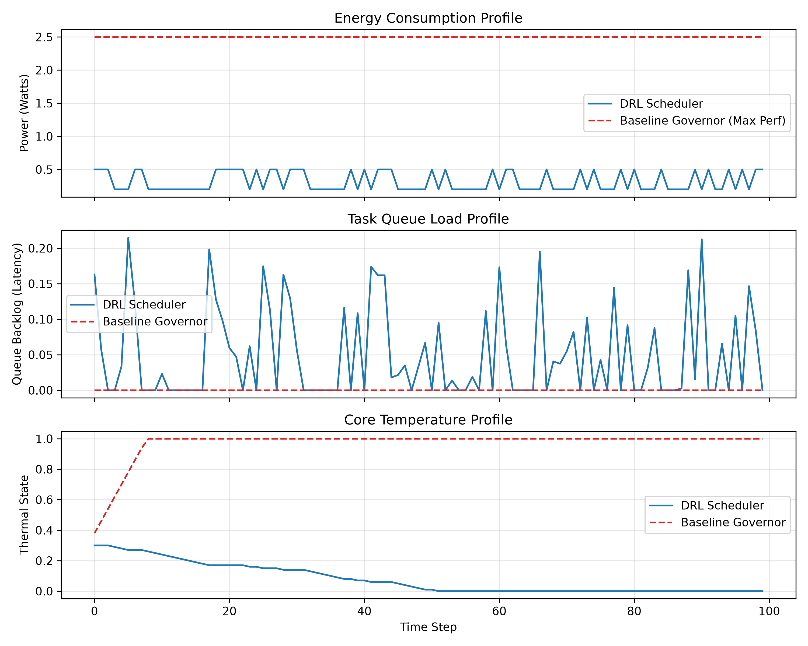

# Energy-Aware Adaptive CPU Scheduling for Heterogeneous Multicore Edge Devices Using DRL

## Abstract
This project presents a simulation prototype for dynamic CPU core scheduling on ARM big.LITTLE heterogeneous architectures using Deep Reinforcement Learning (Proximal Policy Optimization - PPO). The scheduler optimizes task queue latency, power draw, and thermal throttling in real-time.

## Project Architecture
- **Environment:** Custom Gymnasium environment modeling ARM big.LITTLE core power/frequency states (`EdgeSchedulerEnv`).
- **Agent:** Stable-Baselines3 PPO policy.
- **Evaluation:** Evaluated against baseline Linux max-performance governors.

## Benchmark Results

